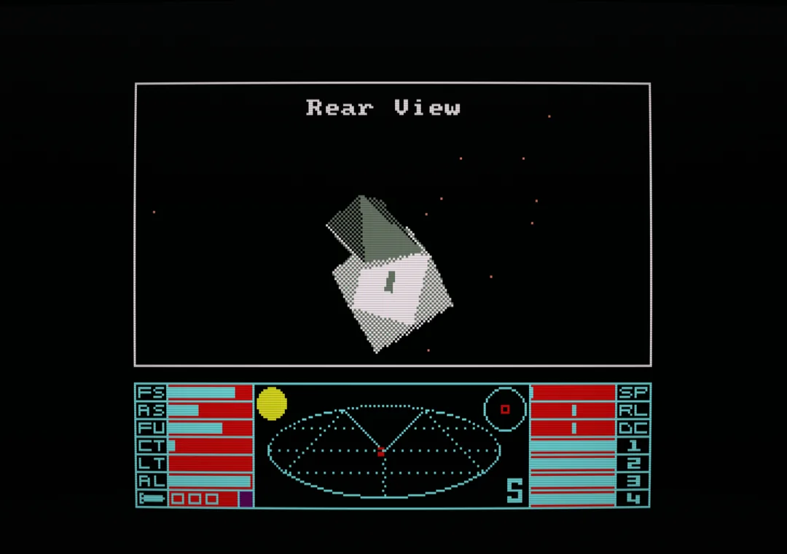
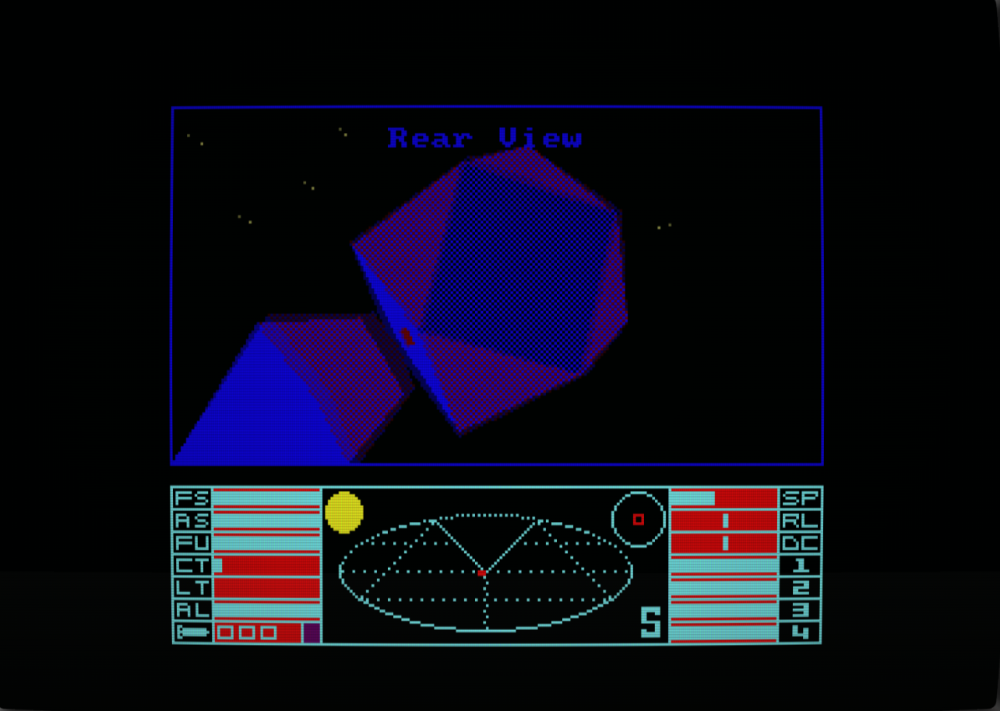
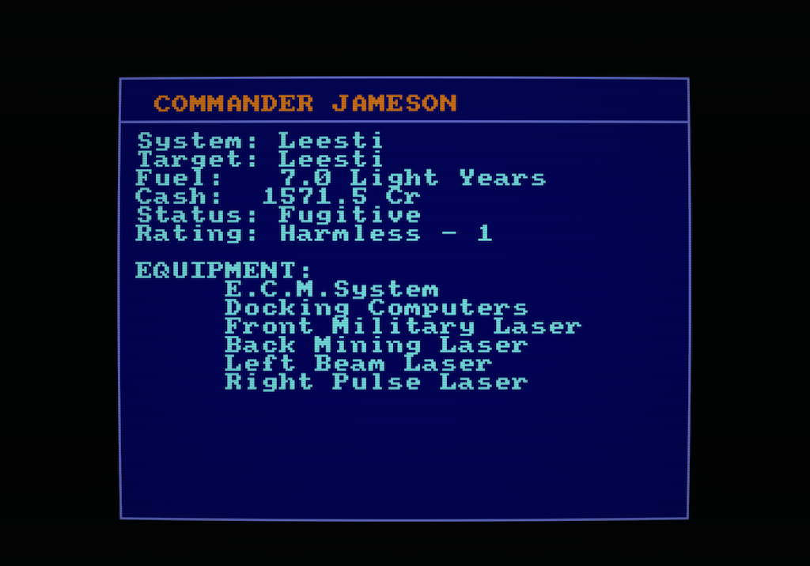
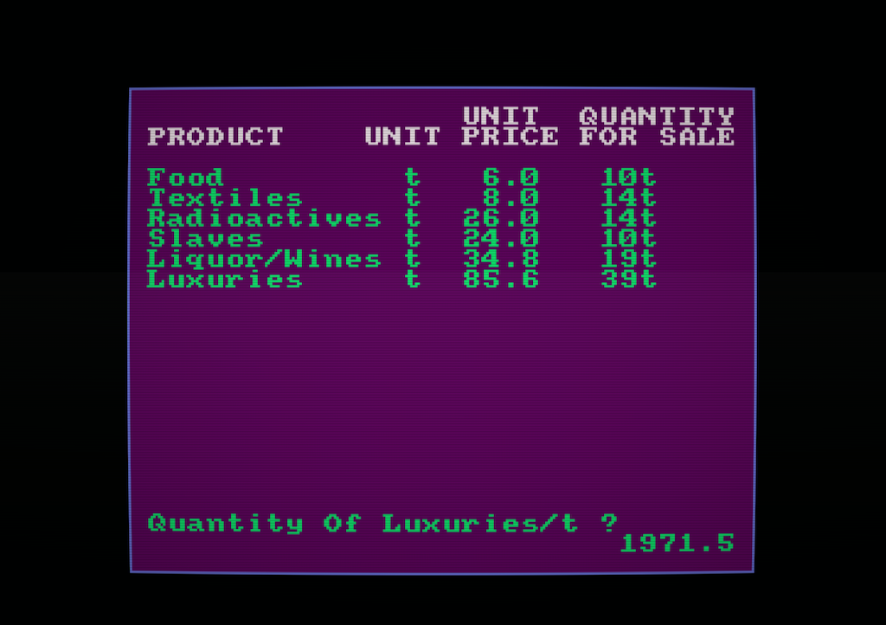
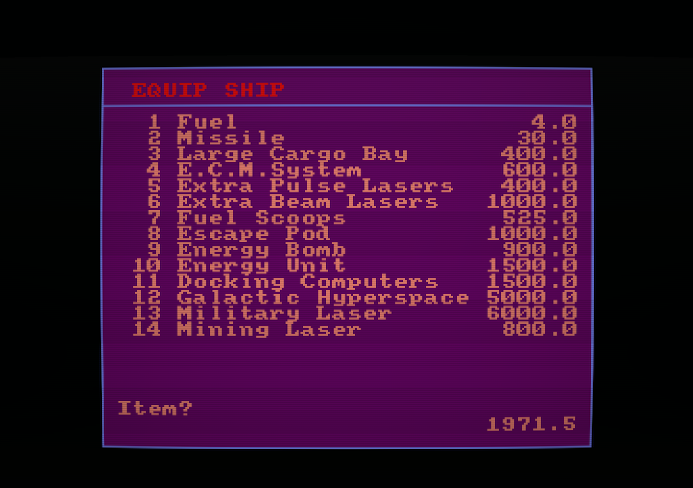
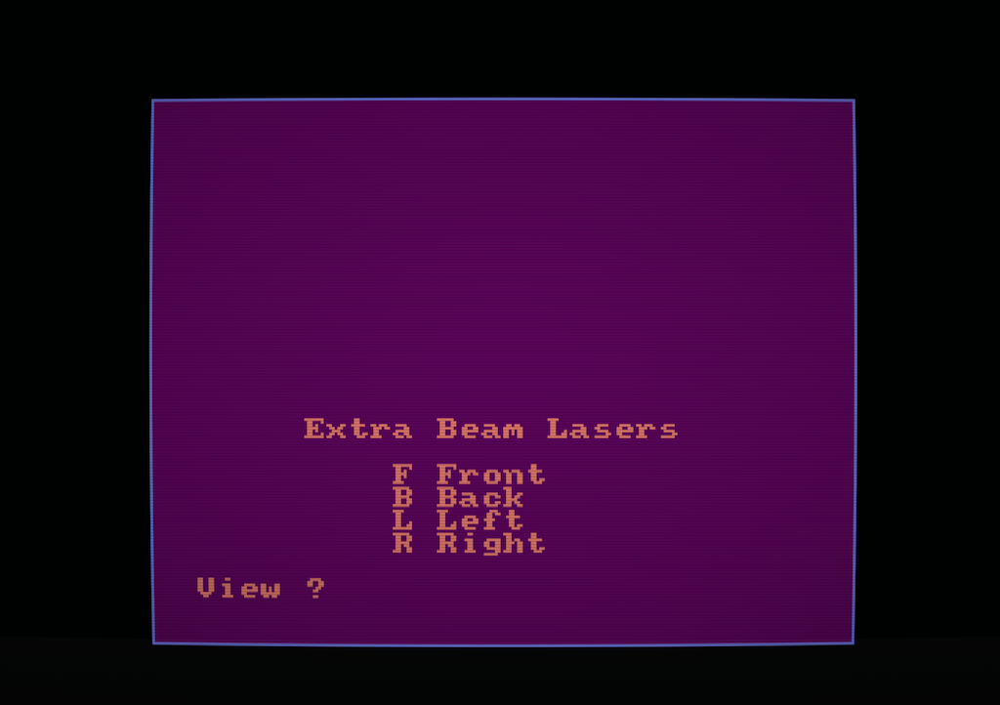
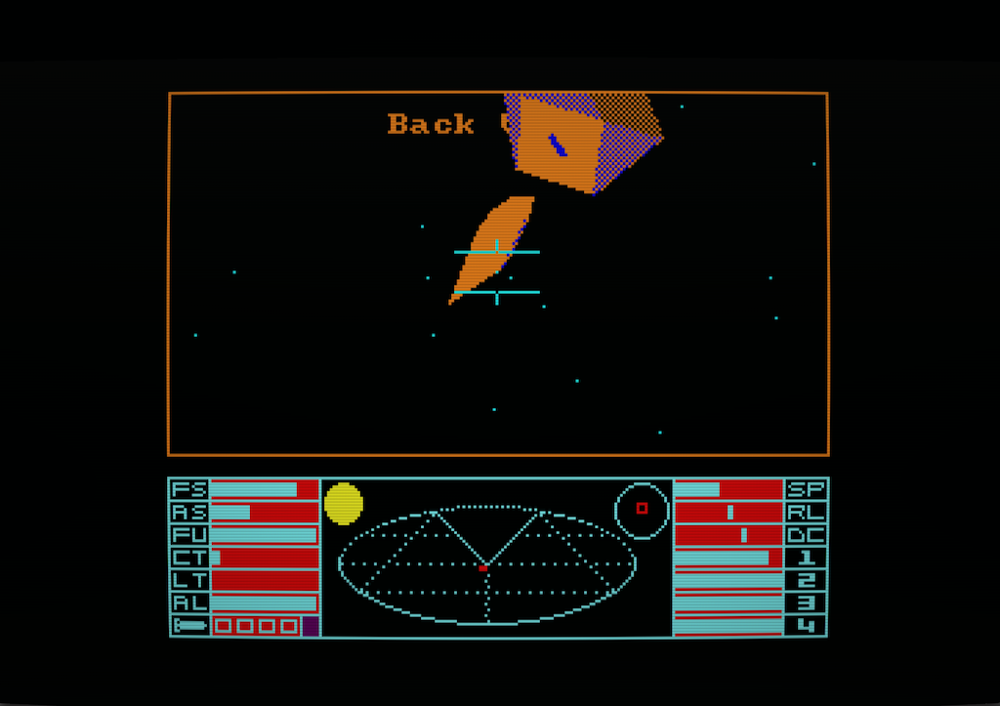
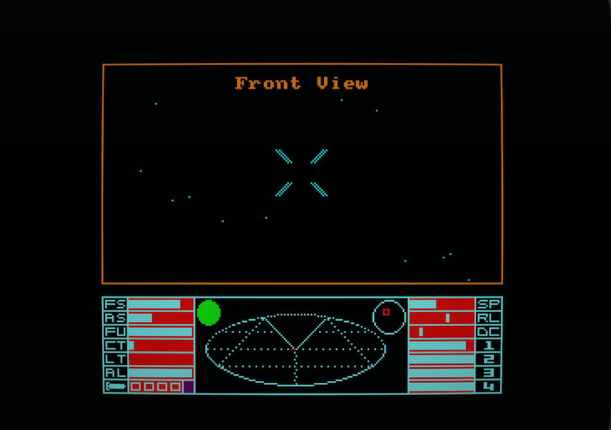

# Elite for the Amstrad CPC, taken apart and slightly improved

## Introduction

This repo contains a disassembled, readable and commented version of the Amstrad CPC *Elite* (Firebird, 1985, a Z80 port of the Spectrum game). The disassembly was made for educational purposes only.

I then used the source code to build two enhanced versions of *Elite*, with the goal of improving the Elite experience more than four decades after the game's release: a **64K build** that runs on any CPC and a **128K build** for the CPC 6128.

The major difference is that the 128K version draws ships as filled polygons, not wireframes, as the Acorn Archimedes version (ArcElite) does. The shapes are my own, built from the CPC game's own ship data.

<p>


</p>

Both contain:

- more secret missions (taken from the other versions of the game)
- more ships (also taken from other versions)
- more encounters, with ship start positions more randomised
- a different sight for each laser type, as on the C64 and Atari ST
- quality-of-life improvements in the UI

<p>


</p>
<p>


</p>
<p>


</p>

The goal was a richer experience inside the existing game. It is deliberately not a rebuild like [Elite-A](https://elite.bbcelite.com/elite-a/), Angus Duggan's extended BBC version, which adds new mechanisms and components on top of the original. Here, I wanted to build the best 8-bit version possible.

The challenge is the (RAM) space. The 64K build has to run on a stock 64 KB CPC 464, and Elite was already a tight game: the added code lives in a few hundred free bytes, in overlays loaded from disk and in bytes saved elsewhere. The CPC also has no hardware sprites, so everything is drawn in software. Its code is about the size of the Spectrum version it was ported from (roughly 29 KB), with more graphics data, and the whole game is well over twice the size of the 6502 BBC Micro version. The 128K build has more room, but code can only live in a few places, so it is tight too (`docs/_128k_version.md`).

**You need your own copy of the original game.** The builds are made from it and contain its code, so they are for your own use: do not share the disks.

## Quick start

1. Put your own copy of the original game's disks in `disks/` (`docs/_disks.md` lists them).
2. Install the tools (Python 3, sjasmplus, iDSK): `bash scripts/install-tools.sh`.
3. Build a disk and boot it in an emulator (RVM, MAME or cpcxray):

```bash
make expanded    # the 64K build  -> build/elite64.dsk,  boot with RUN"ELITE64
make disk6128    # the 128K build -> build/elite128.dsk, boot with RUN"ELITE128 (CPC 6128 only)
```

`RUN"TRAINER` (see *Additional BASIC tools*) jumps ahead to the added missions.

### 64K vs. 128K

| | 64K build | 128K build |
|---|---|---|
| Runs on | CPC 464, 664 and 6128 | CPC 6128 only |
| Boot | `RUN"ELITE64` | `RUN"ELITE128` |
| Ships | wireframe, as in the original | filled, dithered polygons |
| Memory | the stock 64 KB: the added code lives in free bytes and in overlays and ship packs loaded from disk | the second 64 KB holds everything, loaded once at start: no loading pauses |
| Options | switches in the source (`-D` flags) | always on |
| Languages | English; German and French only as source and `make original LOC=de` / `LOC=fr`, without the added missions | English only |
| Build | `make expanded` | `make disk6128` |

## Feature Details

### Secret Missions

The Amstrad CPC game came with three scripted missions, like most of the 8-bit ports. But all games had different missions - with some overlaps. I **extended them to eight**: five more, borrowed from other versions of the game.

| Source | Missions |
|---|---|
| the Amstrad CPC game itself (the stock missions) | 3 |
| the BBC Micro disc version (and its relatives: Master, Apple II, Atari ST, MSX, C64, NES) | 2 |
| the C64 and NES versions | 1 |
| *Elite Plus* for the PC | 2 |

The added missions are for the **English build only**: the German and French builds have too little free space for them (the tail of `COMMONXX` holds 282 bytes in German and 195 in French against 610 in English, and the English missions, their texts and the flight images already fill it), so the localized ports keep the three stock missions.

What the missions are, where they start and what they pay is the point of finding out: **it is not written here**. Play it. (The research notes in `docs/` do spoil everything, so read those afterwards.)

### Fuller Skies

The stock game has few ship types and a quiet sky. This build fills it up, in three ways:

- **More ships in space.** The stock game has 19 ship types. Seven more (Gecko, Moray, Mamba, Adder, Boa, Anaconda and Shuttle, hulls by Fessor) come in seven small "ship packs" on the disk. With no mission active, one pack is chosen for each system visit and loaded at the first launch (about 2 s, only when the pack changes); in it the new ships replace some Sidewinders, Kraits and traders at random, and the stock ships stay. Missions in progress use their own images, so no extras then (`-DMISSIONS`, English only, for the same lack of space in the German and French builds; `docs/_ship_packs.md`). **128K:** all nine pack hulls (the Cobra Mk I and the Worm too) are always there and drawn filled like the stock ships; the pack is drawn at random at every launch from RAM, so there is no loading pause.
- **Busier space, like the C64.** The spawn roll is named and tuned towards the C64 version: more hostiles per check, about 3.5 times the asteroids, escort packs of one to four (`-DTRAFFIC`, all three languages, on in the disks; the stock values stay in comments; `docs/_ship_packs.md`). **128K:** on.
- **Hostile ships come from more directions.** In the original, pirates and Thargoids always start at one of four fixed spots in the corners ahead of you. Now they appear at a random distance and from anywhere in front of you and to the sides, but never from straight behind (`-DSPAWN_VARIANCE`, on in the English mission and expanded disks; `SPAWN_VARIANCE` in `src/elite128/config.inc` for the 128K build; `docs/_ship_spawning.md`). **128K only:** escort packs stay together and asteroids start anywhere around you, flying towards you with a small error; traders still start as before.

### Small improvements

Besides the missions, the build has a few changes that make the game nicer to play. In the 64K build they are switches in the source (`docs/_build.md`, "Switches"), and `tools/check_src.sh` proves that without the switches the original bytes come back (apart from the CPC+ keyboard fix, which is always on). In the 128K build (`src/elite128`, `docs/_128k_version.md`) all of them are always on, there are no switches to set; a note marked **128K** says where it differs.

- **Browse the ships on the "Press Space" screen.** "Cursor Left" and "Cursor Right", or the joystick, step the demo ship through eight hulls (Viper, Asp, Cobra Mk III, Fer-de-Lance, Sidewinder, Krait, Rock Hermit, Thargoid), so you can look at all of them (it only changes the demo ship, not the one you fly) (switch `TITLESEL`, in all three languages, on in the disks). In the English build the press-space screen shows the ship's name, in the ship colour, where the ELITE title stood. **128K:** all 29 hulls, drawn filled, with their names.
- **A sight for each laser.** The pulse laser keeps the cross; the beam, military and mining lasers get their own sights (two bracketed bars, four diagonals, bars with a dot), as on the C64 and Atari ST, and there is no sight without a laser (`-DENHANCED`, `lasersights.asm`, all three languages). Not on the mission disk: the missions fill the free flight memory it would need (English only without `-DMISSIONS`). **128K:** always, with the missions too (it is an overlay copied over the boot code, so it needs no free flight memory; `src/elite128/lasersights128.asm`).
- **Stars stay behind the planet and sun.** The stars used to be drawn over the planet and sun discs, so they shone through them. Now they only appear against empty space (switch `STAR_OCCLUDE`, in all three languages). Ships are still wireframes, so you see stars between their edges, as in the original. **128K:** yes.

### UI Quality of Life Improvements

- **The keyboard reacts faster.** Before every key read the game waited 128 interrupts, which is 0.43 s on the CPC (the interrupt fires six times per frame, so the "128 frames" in the old comment were never frames). With `-DENHANCED` it waits 48, about 0.16 s (one operand byte in `sub_403E`, measured in the emulator: 425 ms against 160 ms), so menus, quantity prompts and Press Space feel quicker. **128K:** yes.
- **Cash on the quantity line.** The buy, sell and equipment prompts show your credits at the bottom right, on the row where you type the quantity, and refresh after every purchase (`-DENHANCED`, English only so far). **128K:** yes.
- **Laser position by letter.** Buying a laser asks for the view with the keys F, B, L and R ("F Front", "B Back", "L Left", "R Right") instead of 0 to 3; the rear view is called "Back" now, in flight too (`-DENHANCED`, English only so far). **128K:** yes.
- **Kill count on the status page.** "Rating: Competent - 300": the rank is followed by your kills (`-DENHANCED`, English, in the mission build too: `killcount.asm`, 26 bytes in every flight image). **128K:** yes (its own routine in the resident glue).
- **"Escape" leaves the buy, sell and equipment prompts.** "Escape" now backs out of them (switch `ESC_KEYCODE`; the stock game ignores that key there). **128K:** yes.
- **"A" sells the whole hold.** In the sell menu, "A" at any quantity prompt sells every good you carry at once (with the trade sound) and returns to the inventory screen; the other keys still just leave the menu (`-DENHANCED`, English only so far; `src/elite/sell_all.asm`). **128K:** yes (`src/elite128/sell_all.asm`).
- **Improved readability.** The station screens line up: every headline starts in column 2, the status screen reads "System:", "Target:", "Fuel:", "Cash:", "Status:" and "Rating:" with the values in one column ("Legal Status" is now just "Status"), and the hyperspace countdown moved to column 6 so it no longer covers the headline (`-DENHANCED`, English only so far). **128K:** yes.
- **The keyboard works on a CPC464+/6128+.** The original game's keyboard is dead on a Plus machine; one byte in the keyboard scan (`getPPI_Input`, `ED 79` -> `ED 49`, found by diffing Redbox's patched disk) fixes it. It is not a switch, and the German stock disk already has it. Not tried on real Plus hardware; details in `docs/_cpcplus.md`. **128K:** the same byte.

### Tools

- **A viewer for ships and objects.** `RUN"SHOWSHPS` shows all 30 models of the game as a rotating hidden-line wireframe with name, kills, bounty, speed and energy: the 19 types of the stock game (11 ships and 8 objects: the Coriolis station, missile, escape pod, cargo canister, alloy plate, splinter, asteroid and rock hermit) and 11 that I added (10 ships, among them Fessor's hulls, and the new Boulder). The arrow keys step through them, "Q" quits. It runs on the mission disk and on its own blank disk (`tools/build_showship.sh`, about 8 frames a second). **128K:** `RUN"SHOWSHPS` on the 128K disk shows 29 ships as filled, rotating models with the same name line, frame and numbers (a different program, `src/viewer128/`; the Boulder is not a 128K hull); the title screen's ship selector (below) shows the same 29.
- **Additional BASIC tools.** On the expanded and 128K disks (the 128K ones use the 128K addresses and key):
  - `RUN"TRAINER` is my trainer, which replaces Firebird's `CHEAT.BAS`: prompts for cheats, kills, jumps and mission presets, so the added missions can be reached without hours of play.
  - `RUN"EDITSAVE` edits a save; `RUN"LISTSAVE` lists the saves on a disk with build, kills and cash.
  - `RUN"CONVSAVE` converts a save between the UK, French, German and 128K builds, either way, because every build encrypts its saves with its own key.
  - On the host, `tools/saveedit.py` edits a save and converts it between the builds (`--to-key-disk`).

### What is in here

| Part | What it is |
|---|---|
| `src/elite/` | the stock English game as **commented source in sjasmplus syntax** that assembles to the original bytes (`LARGEAXX`, `COMMONXX`, `COMMON2X`, `MUSIQUEX`, about 20,000 lines) |
| `src/elite_de/`, `src/elite_fr/` | the German and French builds, same names and comments carried over, also byte-exact; without the missions and ship packs, which do not fit their smaller free tails |
| `src/elite/missions_*.asm` | the added missions: code, text and one ship model, assembled only with `-DMISSIONS` so the stock build stays untouched; also the extra ship hulls and the ship packs (`missions_ships.asm`, `missions_flight_k.asm`) |
| `src/*/lasersights.asm`, `src/elite/killcount.asm` | the per-laser sights (the same file in all three trees) and the kill count of the status page (English), included into the free tail of `COMMONXX` (`-DENHANCED`) |
| `src/cheats/` | a trainer, a save viewer, a save editor and a save converter, all written in CPC BASIC, and `SHOWSHPS.BAS`, a viewer for all the ships (BASIC plus a small Z80 routine) |
| `tools/` | Python helpers: disassembler and verifier, disk reader and writer, text compressor, sprite converter, savegame decoder and editor, emulator tests |
| `docs/` | notes by topic: building and the switches, what I changed in the game, memory map, architecture, save format, cheats, disks, the other versions' missions (research), the implemented missions, and open questions |

## Build and run

Requirements: Python 3, [sjasmplus](https://github.com/z00m128/sjasmplus) and iDSK (`bash scripts/install-tools.sh` installs both), your own original disks in `disks/`, and an emulator (RVM, MAME or the analysis emulator cpcxray, which the tests use).

```bash
make expanded    # 64K build: improvements, all missions and ship packs, BASIC tools -> build/elite64.dsk (English only for now)
make disk6128    # 128K build, CPC 6128 only -> build/elite128.dsk
make missions    # 64K improvements plus the added missions, no BASIC tools -> build/elite_missions.dsk
make original    # the original game, unchanged, on a bootable disk -> build/elite_original.dsk (LOC=de or LOC=fr for German / French)
make check       # the source assembles to the original bytes (English, German, French)
make test        # rebuild the disks and run the host tests (about a minute)
```

Boot with `RUN"ELITE64` (the 64K expanded disk), `RUN"ELITE128` (the 128K disk) or `RUN"ELITE` (the original and mission disks).

How the source was made, the switches (`-D` flags), the memory budget and every change to the game: `src/elite/README.md`, `docs/_build.md`, `docs/_memory_map.md`, `docs/_my_changes.md`.

## Tests

`make test` rebuilds the disks and runs the host checks in seconds: the source against the original bytes, the save tools and the disk rules. `make test-emu` runs the emulator tests of the 64K build (about 4 minutes) and `python3 -I tools/tests/run_all.py --emu128` those of the 128K build. They drive the game from Python (`tools/tests/test_*.py`, `test_*128.py`; index in `tools/tests/README.md`): the docked stub and overlays, the launch image picker, the ship packs, the spawn and kill hooks of every mission, the sprites of one mission, the save tools and, for the 128K build, the filled hulls, the page flip and the file menu. The tests force game states and call routines directly. They do not replace playing through the whole game with save and load, which is still open.

## More

The notes live in `docs/`, one file per topic (`docs/_*.md`); the main ones:

- `docs/_build.md` building, switches and what the checker proves, `docs/_my_changes.md` every change I made to the game, `docs/_memory_map.md` memory map, swapping and free space (the 128K build: `docs/_memory_map_128k.md`)
- `docs/_architecture.md` design, dead code and the dynamic labels
- `docs/_ship_packs.md` the extra ships, the ship packs, the traffic constants and how they are tested
- `docs/_missions_built.md` the implemented missions (spoilers), `docs/_missions.md` the research on the other versions (spoilers)
- `docs/_savegame.md` the save format, `docs/_cheats.md` the trainer, save tools and the ship viewer
- `docs/_open_questions.md` what is unverified, with how to settle it
- `CHANGELOG.md` what changed and why, `TODO.md` what is open, `CLAUDE.md` working notes for the tooling

## Credits and sources

*Elite* is by David Braben and Ian Bell; the CPC version is the Firebird port. Mark Moxon's annotated BBC Micro, C64 and NES sources (elite.bbcelite.com) and Andy McFadden's Apple II disassembly were read for behaviour only; the Z80 here is written fresh. The Atari ST source, the MSX and ZX Spectrum (SkoolKit) disassemblies, the *Elite Plus* decompilation work by rembish and the CPC reconstruction by Fessor were used as references. **Fessor** (CPCWiki, thread "Expanding Elite") disassembled the CPC game first: the Constrictor hull in `src/elite/missions_hull.asm` and the extra ship hulls in `src/elite/missions_ships.asm` (Gecko, Cobra Mk I, Worm, Moray, Mamba, Adder, Boa, Anaconda, Shuttle, Boulder) are his, and many routine and variable names, the ship layout and the symbol list come from his work. The rest of his source, beta disk and forum pages are not part of this repository (he asked that they not be redistributed); they are in his thread, linked in `docs/_references.md`.

## Legal

The disassembly stays under the original copyright; it is here for education, study and preservation. What the licences cover, and what they do not: `NOTICE` and `LICENSE`.
